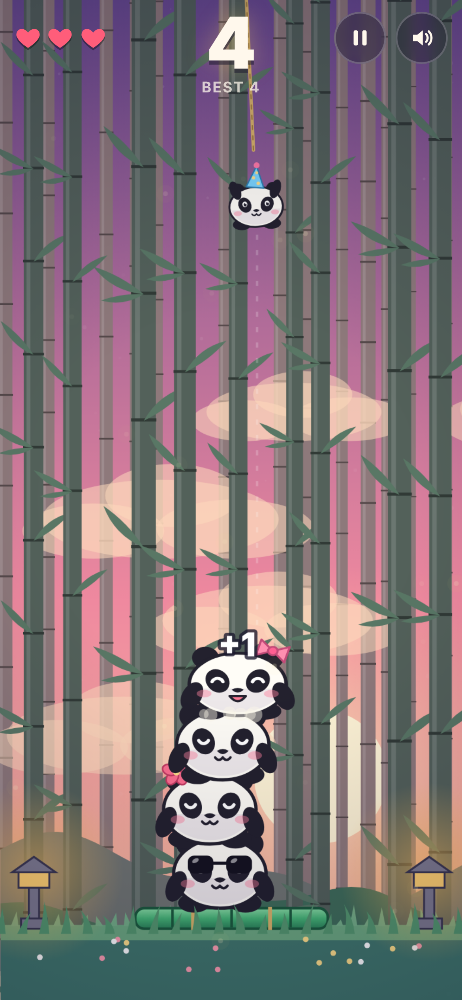

# Panda Stack 🐼

Swing, drop and stack sleepy pandas from sunset to the stars. Built with plain JavaScript and HTML5 Canvas — no dependencies, no image assets, nothing to build.

**Live demo:** https://gvnghiem.github.io/panda-stack/



## How to play
A panda swings in on a rope. **Tap / click / press Space** to drop it onto the tower.
- Land it near the middle for a **Perfect** (it snaps into place) — chain Perfects for a combo and bonus points.
- Every 5 Perfects in a row earns an extra life (up to 5).
- The tower obeys centre-of-mass: stack too far off-centre and everything above the weak spot **topples** (lose a life). Miss entirely and the panda falls past (lose a life).
- Watch the pandas' faces — they get worried when the tower is close to tipping.
- The sky changes as you climb: sunset → dusk → moonlit night → aurora.

**Keys:** Space / Enter / ↓ drop · P or Esc pause · M mute

## What's new in this version
- New twilight-bamboo-grove theme, parallax scenery, fireflies, moon, stars and aurora
- Hand-drawn (in code) pandas with expressions and 8 accessories
- Swing-and-drop gameplay with Perfect combos and a physics-flavoured topple rule
- Responsive: one tall play column, scaled to any screen; wide windows get scenery at the sides
- Touch-first: one-tap controls, 44px+ buttons, safe-area aware, no zoom/scroll/pull-to-refresh
- Synthesised sound (no mp3s needed), mute toggle, haptics on supported phones
- Pause (also auto-pauses when the tab loses focus), best score saved locally, installable (web manifest)
- Respects `prefers-reduced-motion`

## Run locally
```bash
git clone https://github.com/gvnghiem/panda-stack.git
cd panda-stack
python3 -m http.server   # then open http://localhost:8000
```

## Files
`index.html` · `styles.css` · `game.js` · `icon.svg` · `manifest.webmanifest`.
The original `panda.png`, `sky.png`, `grass.png` and `.mp3` files are no longer used and can be deleted.

## Credits
Built by gvnghiem. Original version used artwork from openclipart.org and sounds from 101 Soundboards; this version draws everything in code and synthesises its audio.
